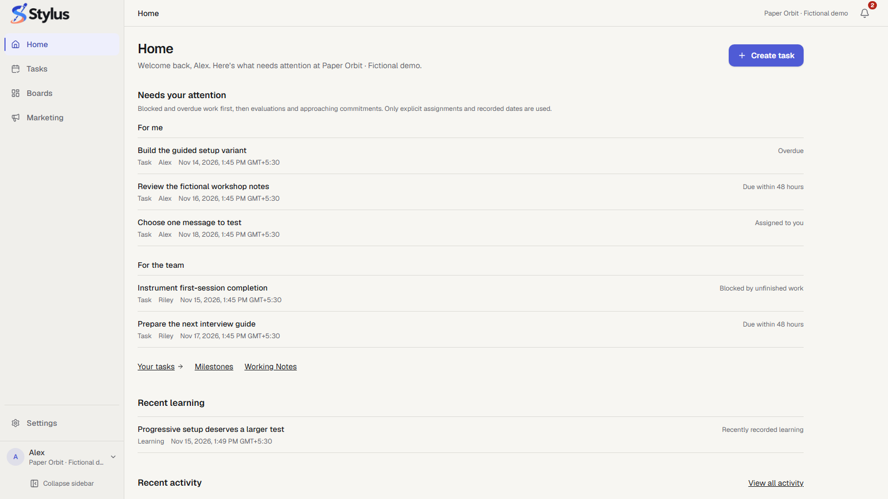
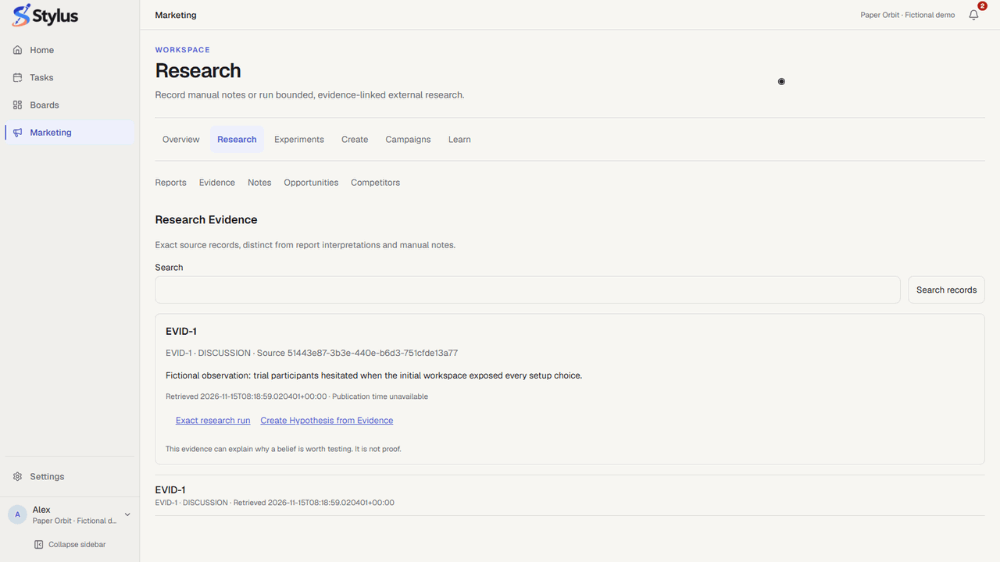
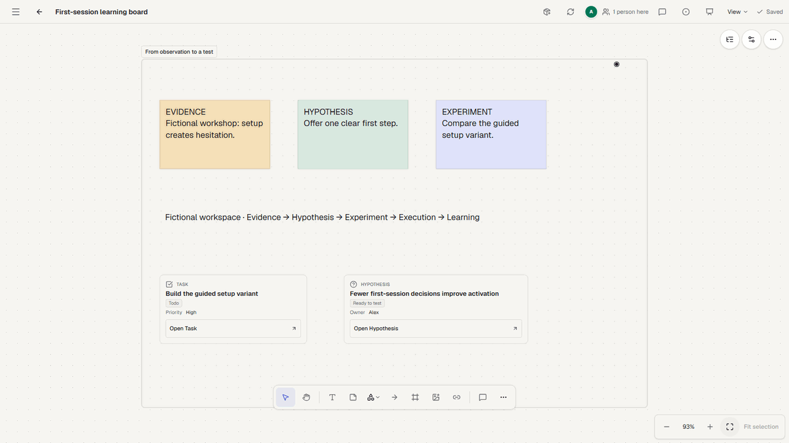
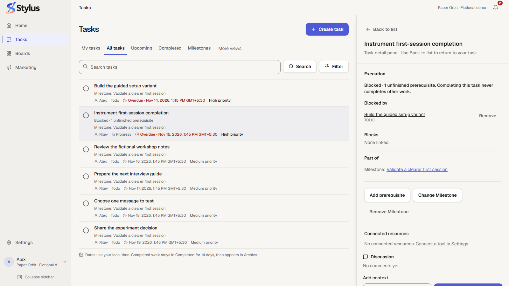
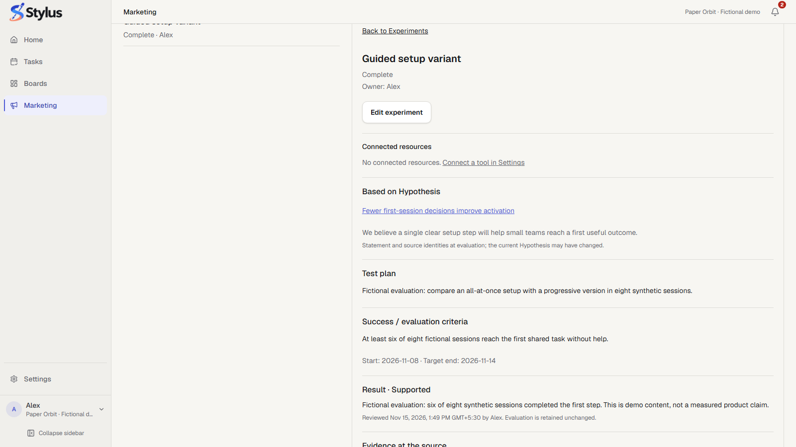
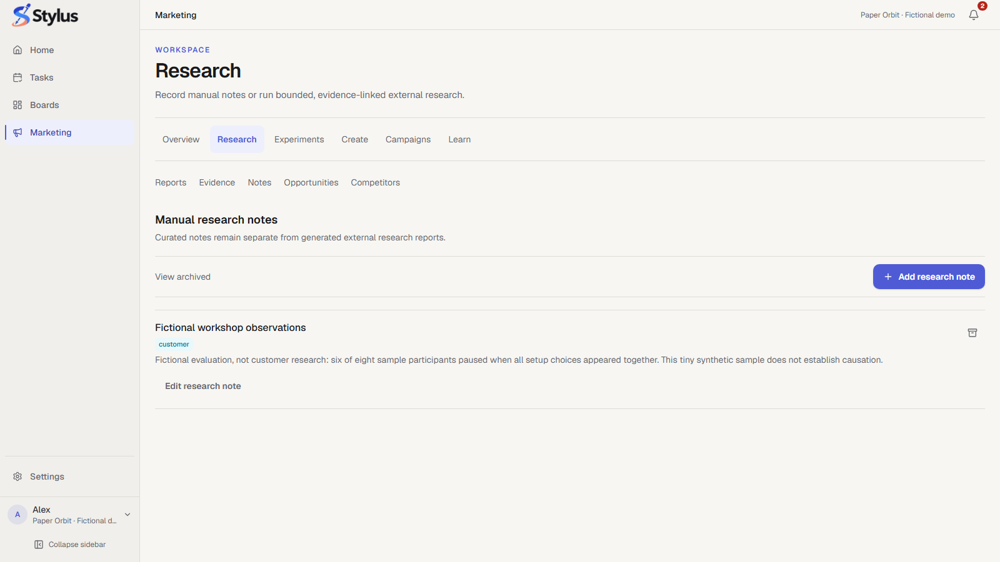
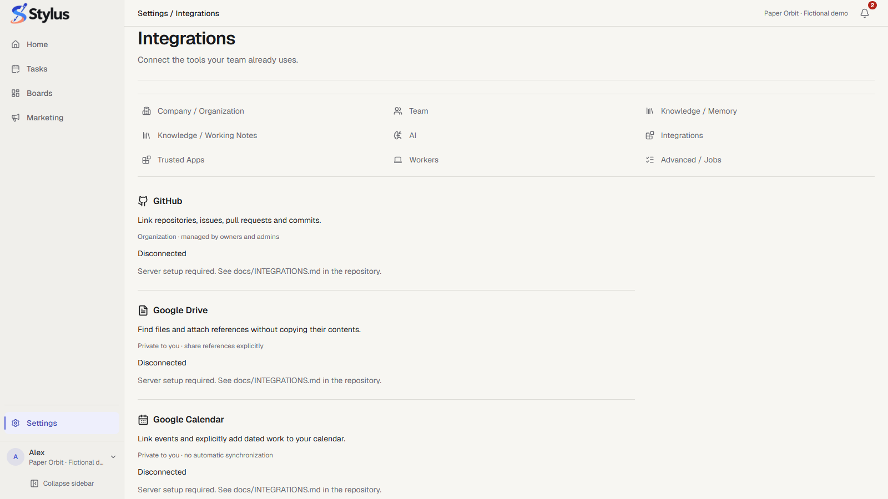

# Stylus

**From evidence to execution.**

Stylus is an open-source operating system for early-stage teams to turn customer
and market evidence into experiments, decisions, execution and learning.

Bring research, ideas, Experiments, Tasks, Boards and team knowledge into one
connected workspace. See what needs doing, the evidence behind it and what your
team has learned.

Built for founders and small teams. Self-hostable, with optional AI and
integrations; Core works without either.



## Why Stylus

Evidence is easy to collect and easy to lose. A task list alone rarely explains
why the work matters. Stylus links an observation, a testable belief, an experiment,
execution work and a reviewed conclusion.

```text
Evidence → Hypothesis → Experiment → Tasks and decisions → Learning
                                                            ↓
                                             explicit Company Memory
```

The links are canonical records with exact provenance. A Board card points to the
original work. A Learning becomes Company Memory only through reviewed promotion.

A fictional team hears in customer interviews that new users struggle with setup.
They record the Evidence, hypothesize that a shorter checklist could help, and
plan an Experiment with assigned Tasks. They review the result as Learning and
explicitly choose whether to promote it to Company Memory.



## A workspace for the operating loop

- **Daily execution:** See what needs attention and why. Tasks connect owners,
  deadlines, prerequisites and Milestones, with detail that opens alongside the list.
- **Visual work:** Explore ideas together on Boards with Sections, notes and images.
  Native cards link back to actual Stylus records; comments, voting and Section
  presentation help teams review and decide.
- **Growth and learning:** Marketing connects Evidence, Hypotheses, Experiments and
  Campaigns so teams can test ideas and record Learning. Creative Studio and Ask
  Council support distinct bounded workflows.
- **Context:** Keep working Notes separate from approved Company Memory, so
  exploratory thinking stays distinct from reviewed knowledge. Onboarding supplies
  explicit company context.
- **Connected tools:** Keep execution linked to GitHub repositories/Issues/PRs/Commits,
  Drive metadata and Calendar events. Create Calendar events explicitly; automatic
  sync is not implemented.



<details>
<summary>More product views</summary>






</details>

Media uses the fictional Paper Orbit workspace. Results are synthetic examples,
not customer outcomes. [Full-size video, capture provenance and sizes](docs/MEDIA.md).

## Run it yourself

Use Node.js 24 LTS, npm and Supabase. For a new local development stack on a
machine with a working Docker-compatible engine:

```sh
git clone https://github.com/AwesomeWiz/stylus.git
cd stylus
npm ci
npx --no-install supabase start
node scripts/setup-local-env.mjs
npm run dev
```

Open `http://localhost:3000`, create an account/organization and finish onboarding.
The helper creates an ignored local environment file and refuses to overwrite one.
First-time backend downloads can take longer than the application install.

The [self-host guide](docs/SELF_HOSTING.md) covers your own hosted Supabase project,
forward migrations, production hosting and troubleshooting. There is no dependency
on the maintainer's backend.

Native Linux CI covers fresh Supabase setup, web/worker tests, SQL/RLS assertions,
real authentication and Chromium/Firefox/WebKit smoke tests.
[Release verification](docs/RELEASE_AUDIT.md) records the exact CI-tested candidate,
guarded demo cleanup and remaining manual checks.

Try the [optional fictional demo](docs/DEMO.md), or start empty.

## Optional AI and integrations

Configured AI operations run through ModelGateway using logical capabilities and
bounded, auditable workflows. Existing adapters support Ollama and OpenAI-compatible
endpoints; no paid OpenAI account is required. An optional outbound Windows worker
handles heavy media jobs, which remain queued while it is offline.

End users connect the deployment's configured GitHub/Google app. Only self-hosting
operators create provider apps and manage encryption keys.
[Integration setup](docs/INTEGRATIONS.md) documents those roles and exact scopes.
For deployments that enable Google Drive, its restricted metadata scope can
require Google's OAuth verification.
File ingestion, GitHub writes and automatic Calendar sync are not implemented.

## Architecture and security

A modular monolith built with Next.js/React/TypeScript and Supabase. Core owns shared
collaboration; Marketing is a plugin behind public contracts. RLS, server
authorization and permanent tests protect tenant/role boundaries. Memory domains
are enforced in code and SQL. Credentials remain server-only; linked metadata
does not change provider sharing permissions.

Read the [architecture overview](docs/ARCHITECTURE_OVERVIEW.md),
[security policy](SECURITY.md), [privacy responsibilities](docs/PRIVACY.md) and
[documentation](docs/README.md). These are safeguards, not a security certification.

## Contribute

See [CONTRIBUTING.md](CONTRIBUTING.md), [SUPPORT.md](SUPPORT.md) and the
[code of conduct](CODE_OF_CONDUCT.md). Contributors retain copyright and contribute
under the project license; no CLA or copyright assignment is required. AI-assisted
contributions are welcome with review and responsibility for the submitted change.

Stylus was built with extensive use of Codex as an implementation agent. Product
direction, architecture, review, testing, maintenance and release responsibility
remain human-directed.

## License and beta status

Original code is [AGPL-3.0-only](LICENSE). Dependencies/fonts retain their
[own terms](docs/THIRD_PARTY.md); see [trademark guidance](TRADEMARKS.md).
Modified network deployments must review corresponding-source requirements.
Future commercial/dual licensing is not promised by contributor terms.

The upcoming beta is **0.1.0-beta.1**; it has not yet been tagged or published as a
GitHub release. The source is public and self-hostable; hosted services have their
own deployment and operating requirements. Read the
[release notes](docs/RELEASE_NOTES.md) and [audit](docs/RELEASE_AUDIT.md) for known
limitations and remaining beta-release checks.
