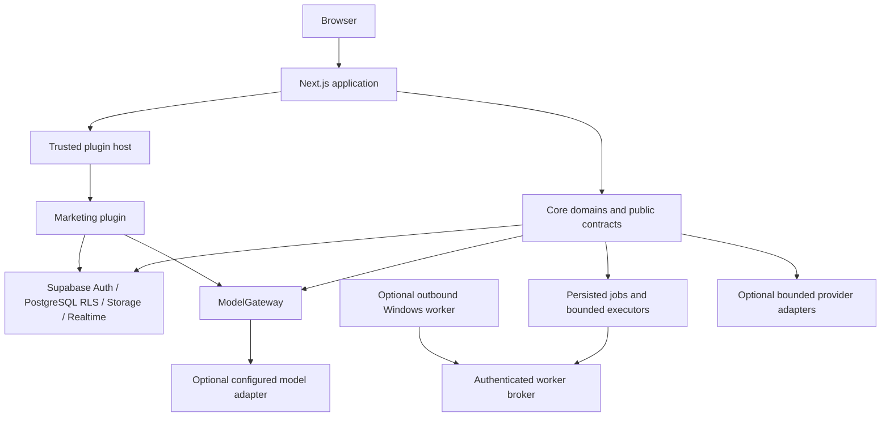

# Architecture overview

Stylus is a TypeScript modular monolith. Next.js serves the application, server
actions and read-only routes. Supabase provides Auth, PostgreSQL/RLS, Realtime and
private Storage. Core remains useful without AI, integrations or an external worker.

Core owns identity, organizations, roles, Tasks, Milestones, Notes, Boards,
notifications/activity, Company Memory, plugin infrastructure, ModelGateway and
Jobs. Marketing owns evidence, hypotheses, experiments, learnings, campaigns and
its bounded research/creative workflows. Core never imports Marketing persistence;
the public host composes provider registrations.

Native Board cards store canonical references, not privileged copies of entity
content. Resolvers/openers recheck tenant, plugin and entity authority. Working
objects become Company Memory only after an explicit reviewed promotion.
Company/marketing/agency memory domains are enforced in code and SQL.

Read-only Task panel requests are independently authorized and uncached, allowing
Core detail/discussion to progress without waiting for a provider's mutation-action
queue. Long-running work uses durable jobs with leases, bounded retries, cancellation
and recovery; a worker connects outbound and never receives the service-role key.

Integrations store encrypted server-only credentials and bounded metadata
references. Google connections are user-private; GitHub is organization-scoped.
Model calls always go through ModelGateway. See [security](../SECURITY.md),
[integrations](INTEGRATIONS.md) and the detailed [implementation architecture](ARCHITECTURE.md).
